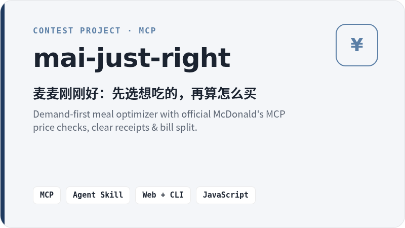

<h1 align="center">teifurin · AI builder🧪</h1>

  

### 👋 About me · 关于我

- 🗼 **Tokyo** · digital nomad / 白天做产品，晚上写小项目
- 🤖 **AI 编程 Agent 重度用户** — 熟悉 Claude、Codex，喜欢从想法一路做到可运行的 Demo
- 🧩 **关注 MCP、Agent Skill 与真实数据接入** — 喜欢“能被验证”的 AI 输出，而不是凭空生成
- 🧪 当前项目以试验、比赛作品和学习笔记为主 / experiments, contest entries & notes

---

### 🗂️ Project Collection · 项目合集

  这里是我的 AI 开发试验田：和 AI 编程 Agent 一起，把一个个小想法做成能跑的小工具。 
  My lab account for small AI tools, built hands-on with AI coding agents.

#### ⭐ Featured · 精选

  
  

  
  &nbsp;
  

| Project | 一句话 | One-liner |
| --- | --- | --- |
| [mai-just-right](https://github.com/teifurin/mai-just-right) | 先选想吃的，再算怎么买：套餐、优惠与预算放在同一张清楚的账单上 | Demand-first McDonald's meal optimizer with official MCP price checks |
| [china-ready](https://github.com/teifurin/china-ready) · [demo](https://teifurin.github.io/china-ready/demo/) | 用日语、英语或韩语写一句话，基于飞猪实时结果排出中国行程，并附上可出示的中文大字卡片 | One sentence becomes a day-by-day China trip on live Fliggy data, with show-to-staff Chinese cards |
| [approval-desk](https://github.com/teifurin/approval-desk) | 人和 Agent 共用一个审批收件箱：规则先判定，人再决定，全程留痕 | One approval inbox shared by people and agents, built on Agent-Native |

#### 🧾 Everyday tools · 日常工具

| Project | 一句话 | One-liner |
| --- | --- | --- |
| [mai-just-right](https://github.com/teifurin/mai-just-right) | 先选想吃的，再算怎么买：套餐、优惠与预算放在同一张清楚的账单上 | Demand-first McDonald's meal optimizer with official MCP price checks |
| [china-ready](https://github.com/teifurin/china-ready) · [demo](https://teifurin.github.io/china-ready/demo/) | 用日语、英语或韩语写一句话，基于飞猪实时结果排出中国行程，并附上可出示的中文大字卡片 | One sentence becomes a day-by-day China trip on live Fliggy data, with show-to-staff Chinese cards |

#### 🛡️ Agent guardrails · Agent 护栏

| Project | 一句话 | One-liner |
| --- | --- | --- |
| [approval-desk](https://github.com/teifurin/approval-desk) | 人和 Agent 共用一个审批收件箱：规则先判定，人再决定，全程留痕 | One approval inbox shared by people and agents, built on Agent-Native |
| [agent-spend-guard](https://github.com/teifurin/agent-spend-guard) | 在 AI Agent 和 PayPal 之间加政策与人工审批护栏（仅 sandbox） | Policy and human-approval guardrail between agents and PayPal (sandbox only) |

#### 🧪 Experiments · 试验与比赛

| Project | 一句话 | One-liner |
| --- | --- | --- |
| [migoro-map-demo](https://github.com/teifurin/migoro-map-demo) | 用 Gemini 解析照片与本文，在依据可见和人工确认后再更新季节观察地图（合成演示数据） | Gemini-powered seasonal observation map with transparent evidence and human review (synthetic demo data) |
| [tamago-coach](https://github.com/teifurin/tamago-coach) | 在 SPECS 眼镜上做免手持的玉子烧教学，火候提示直接叠在锅上 | Hands-free tamagoyaki coaching on Snap Spectacles, built for the Learn AR with SPECS hackathon |

#### 🤝 Open source · 开源参与

| Project | 一句话 | One-liner |
| --- | --- | --- |
| [MiroShark](https://github.com/MiroShark/MiroShark) *(contributor)* | 开源群体智能模拟引擎，用于试验 | An open-source swarm-simulation engine, for experiments |

---

  

Made in Tokyo with AI coding agents · 最后更新 2026-11

