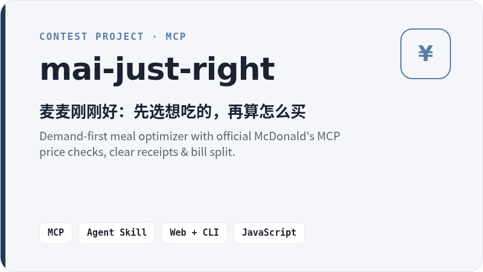
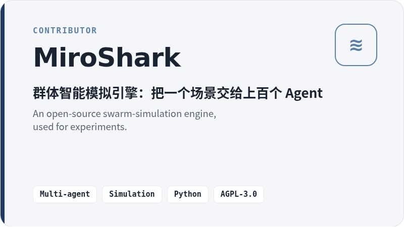

<h1 align="center">teifurin · AI builder🧪</h1>

  

### 👋 About me · 关于我

- 🗼 **Tokyo** · digital nomad / 白天做产品，晚上写小项目
- 🤖 **AI 编程 Agent 重度用户** — 熟悉 Claude、Codex，喜欢从想法一路做到可运行的 Demo
- 🧩 **关注 MCP、Agent Skill 与真实数据接入** — 喜欢“能被验证”的 AI 输出，而不是凭空生成
- 🧪 当前项目以试验、比赛作品和学习笔记为主 / experiments, contest entries & notes

  

---

### 🗂️ Project Collection · 项目合集

  这里是我的 AI 开发试验田：和 AI 编程 Agent 一起，把一个个小想法做成能跑的小工具。 
  My lab account for small AI tools, built hands-on with AI coding agents.

  
  

  
  &nbsp;
  

| Project | 一句话 | One-liner |
| --- | --- | --- |
| [mai-just-right](https://github.com/teifurin/mai-just-right) | 先选想吃的，再算怎么买：套餐、优惠与预算放在同一张清楚的账单上 | Demand-first McDonald's meal optimizer with official MCP price checks |
| [MiroShark](https://github.com/MiroShark/MiroShark) *(contributor)* | 开源群体智能模拟引擎，用于试验 | An open-source swarm-simulation engine, for experiments |

---

Made in Tokyo with AI coding agents · 最后更新 2026-10
